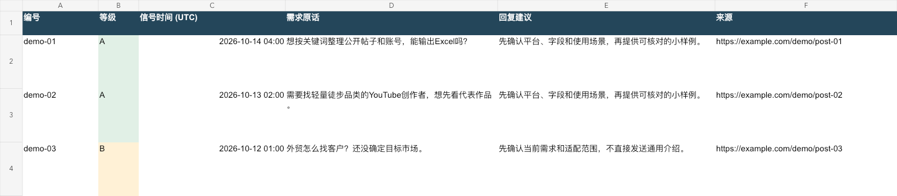

# B端需求信号获客 · b2b-demand-signals

把公开帖子里的近期问题，整理成**带来源、带时间、带优先级的获客研究表**。

你可能已经有一份客户名单，却不知道先联系谁、为什么现在联系。这个skill先找最近有人明确表达的问题：求工具、找服务、需要达人资源、采集卡住，或者正在寻找供应商替代方案。再核对原话、账号和日期，按A/B/C分级，准备有针对性的回复。

**数据由 [ClaudeBaby · claudebaby.cn](https://claudebaby.cn) 提供。这个skill负责研究流程与整理，不自带数据，也不自动群发。**

如果这套方法对你有用，欢迎点一下右上角的 **⭐ Star**，方便以后回来更新。也欢迎带着具体场景提Issue：目标平台、遇到的问题、希望拿到的字段，会比一句“支持更多功能”更容易推进。Star不是使用条件。

## 为什么做这个skill

最开始，我们想给数据研究工具找一些真正有需要的人：有人在找KOL联系方式，有人需要1688的信息，也有人想拿到商品评论或社媒数据。很容易搜出一大堆账号，但看完才发现，不少人在卖服务、分享教程，或者那条求助已经是很久以前的了。

所以我们把问题改成了：**这个人最近遇到了什么，我们能不能先帮他解决一点？** 后来读到[James Shields分享的Reddit故事](https://x.com/i/status/2042324679759978780)：他转述有人每天看细分社区，搜求推荐和替代方案，趁需求刚出现时回应。让我们想留下来的，是“需求出现的时间”，以及首句应该回应原帖，而不是先介绍自己。

原帖提到月入约5.1万美元。这是作者转述，收款和归因没有独立验证，我们也没有靠这个skill验证这份收入。它是做这个流程的一个启发。

第一次拿这套流程查五类需求时，我们保留了269条原始命中，按平台与ID去重后255条，选出18条候选，其中9条A、9条B，只有1条落在4小时内。也有不少“不好看但有用”的结果：1688“拉数据”其实可能在说店铺运营；评论采集卡住不一定是电商评论；几个不同账号的求达人帖，竟然用了很相似的模板。**18条是研究候选，不是18个客户，更没有18笔成交。**

这也是为什么我们坚持把原话、时间、排除项和筛选底稿一起交付。你应该能看清楚它为什么留下一个人，也能看清楚它为什么放弃另一个人。下面的公开Excel仍用虚构数据演示，实际账号与研究底稿不公开上传。

## 多语言：先找到当地人真正怎么问

支持中文、英文、日语、韩语、法语和德语的研究流程。默认先跑中英；目标是其他市场时按预算扩展对应语言。每条保留**原文＋中文释义＋原帖语言的回复草稿**，查询覆盖也按语言分开记录。

例如英语常搜“looking for / alternative to”，日语可以从“探しています / おすすめ”入手，韩语用“추천해주세요 / 찾고 있습니다”，法语用“je cherche / alternative à”，德语用“suche / Alternative zu”。这些是可调整的检索词，不是全平台通用语法。规则详见[多语言参考](references/multilingual.md)。

```text
使用 b2b-demand-signals，按英语、日语、韩语、法语、德语分别查
最近7天求KOL工具、1688数据、商品评论或社媒数据的本人需求。
先做各语种最小查询，再扩展有效的方向；4小时内A级优先。
原文、中文释义和原帖语言回复分列，逐阶段底稿打包Excel。
按语种报告未查、失败与覆盖不足。只拟稿，不发送。
```

## 先看最终表格

[下载Excel示例：近期需求与回复工作台](examples/b2b-demand-signals-demo.xlsx?raw=1)



**示例是完全虚构的离线演示数据**，用于展示字段、时间分级和回复方式。不是实际查询结果，不包含真实账号、客户名单、联系方式或可联系的采购需求。示例中的example.com链接是占位链接。

文件包含近期回复、完整证据、账号资料、历史与日期待核、排除与归档、检索覆盖、方法口径七个sheet。真实任务会写入实际来源链接；评论没有直达入口时，保留父视频链接、昵称、原话和评论ID。

## 哪些情况适合用

| 业务场景 | 要找的信号 | 研究产出 |
| --- | --- | --- |
| 数据与工具服务 | 明确求平台数据、字段、导表、API或替代方案 | 问题原话、平台与字段、账号、回复草稿 |
| KOL与海外红人研究 | 找某品类、地区的达人或公开合作入口 | 具体需求、作品与账号研究方向、待核字段 |
| 外贸与B2B服务 | 新项目、近期求助、替代方案、采购变化 | 有上下文的需求信号，辅助决定先和谁聊 |
| 独立站SEO/GEO服务 | 内容、收录、研究工具或服务商求助 | 区分数据研究与实际执行需求，避免答非所问 |

抱怨不等于要换供应商，发过求助不等于现在还需要。skill会保留这些区别，不把名单数量写成意向客户数量。

## 时间和ABC，怎么判断

默认查**最近7×24小时**，优先使用时间过滤和最新排序，再用实际发布时间核对。接口不支持时本地过滤，并说明覆盖限制。评论按自己的时间评估，不能用主帖日期或抓取时间替代。

| 等级 | 默认规则 | 怎么处理 |
| --- | --- | --- |
| A | 近7天、具体需求、服务直接匹配、未关闭 | 优先研究和准备回复 |
| B | 近7天但需求笼统/间接适配，或8–30天的匹配需求 | 先确认范围；历史项单列 |
| C | 超过30天，或已解决/停止招募/注销/不适配 | 历史归档或排除联系 |

日期未知最多B，放“日期待核”，不混进近期工作台。用户可指定别的窗口，等级规则和报告会同步注明。**A是研究优先级，不是付费或成交承诺。**

## 新增：Reddit每日高意图快线

每天先看5–10个买家常驻社区，固定搜求推荐、竞品替代、找服务、被坑后换供应商、竞品值不值得买五类表达。**A级里优先处理4小时内的精确信号**，其余仍按7天ABC排序；预算、期限与替换意图保留原话，不靠热度猜购买力。

```text
使用 $b2b-demand-signals，根据我们的服务选择5–10个Reddit买家社区，
查最近一天求推荐/替代方案的帖子，优先4小时内明确需求。
每个筛选阶段都给Excel底稿：社区、原始命中、去重、时间核验、
需求判断、账号入口、ABC/快线、回复草稿；不足或截断如实标明。
回复先解决问题，只沿本人公开自链核商务入口。仅拟稿，不发送。
```

可设置“发现后2小时内处理、正向回复后30分钟内响应”的待办目标，具体发送仍须授权。当前Reddit工具说明按旧到新返回，不能假装原生支持最新排序；达到上限时标注最近时段可能漏采。详见[完整快线规则](references/reddit-fastlane.md)。

方法参考[James Shields的X帖](https://x.com/i/status/2042324679759978780)，2026-10-15经ClaudeBaby核到原文。文中月收入与转化率属于作者转述，未经收款与归因验证，并非本项目实测或效果承诺。现有Excel为基础七页虚构演示；实际快线交付再增加四页筛选和响应底稿。

## 一句话调用

安装后，在支持本地skill的Codex环境中输入：

```text
使用 $b2b-demand-signals，找小红书和抖音最近7天内，
明确求社媒数据、KOL筛选或行业研究工具的帖子和评论。
核对发布时间和账号，按ABC分级，整理Excel与原文依据。
回复先解决具体问题，再说明可以帮助的部分。仅拟稿，不发布。
```

换一个业务场景：

```text
使用 $b2b-demand-signals，研究工业零部件采购方近期公开表达的
交期、替代供应商和新项目需求。先确认当前工具覆盖的平台，
优先近7天，不足就如实说明。把潜在线索、原话、时间、来源、
账号、适配理由和待确认事项整理成表，不把一般抱怨当成采购计划。
```

默认流程：明确服务与市场 → 检查数据工具 → 搜近期问题 → 读原文与上下文 → 核账号 → 时间与ABC分级 → 表格与回复草稿。

## 安装：把仓库链接发给 Agent

不需要自己下载、解压或运行命令。复制仓库链接，粘贴到支持 Skills 的 Agent 对话框，再发送：

```text
请从这个 GitHub 仓库为你当前的 Agent 环境安装 Skill：
https://github.com/lingling1989r/b2b-demand-signals

请先检查仓库结构和 SKILL.md，再按当前平台支持的方式安装到可用的 skills 目录；安装后验证文件存在，并告诉我如何调用。不要让我手动 git clone、下载或解压。如果当前环境无法访问 GitHub 或无法写入 skills 目录，请明确告诉我下一步需要做什么，不要声称安装成功。
```

安装完成后，在同一个 Agent 对话中输入：`使用 $b2b-demand-signals，……`，再描述要研究的行业、市场、平台和时间范围。Codex、Claude Code、Cursor、WorkBuddy 等产品能否直接按链接安装，取决于各自当前的 Skill 导入能力；纯网页聊天若不能访问 GitHub 或写入 Skill 目录，就按平台自己的导入方式操作。

安装 Skill 不会自动连接 ClaudeBaby、查询数据或发送消息。已有同名 Skill 时，先检查本地版本，避免覆盖自己的修改。

## 数据从哪里来？

来自 **[ClaudeBaby](https://claudebaby.cn)** 中当前连接实际开放的公开社媒和电商工具。每次先检查工具schema，再做一个最小有效查询。平台、字段、排序方式、时间范围、费用和余额以当前工具返回及控制台为准；连接成功不等于所有平台和字段都可用。

没有连接时，先到 [claudebaby.cn](https://claudebaby.cn) 查看并配置。可选[邀请注册入口](https://claudebaby.cn/console/register?ref=M8YYGRN4)，邀请码`M8YYGRN4`；具体额度和计费以控制台当时说明为准。已有连接直接使用，不必重复注册。

本仓库不包含API密钥、私有原始数据、平台爬虫或绕过登录/风控的程序。实际研究依赖宿主提供的ClaudeBaby工具；本地脚本只做输入记录的时间分级。

## 回复应该长什么样

比如有人说“美国市场名单联系了很多，但没什么回复”，先讨论两点：对方是否最近有采购或换供应商动机；这个品类是否还需要样品、展会等信任建立方式。之后才接上真正匹配的服务。

不会给每条回复机械加“我是某某团队的”。涉及自己的业务会如实说“我们有这类数据/能做这部分”，也不会装作无利益关系的路人推荐。展会协助、拍摄等属于可配置的服务背景，**不是skill自动执行的功能**。

评论、私信、邮件默认都只是草稿。实际发送必须有当前任务的明确授权，并遵守可用工具和平台边界。

## 与social-case-to-excel有什么区别

- 本skill：决定哪些需求值得近期回应，怎样按时间和适配分级，怎么写有帮助的回复。
- [social-case-to-excel](https://github.com/lingling1989r/social-case-to-excel)：把社媒证据整理成有原帖配图的多sheet Excel、方法拆解和图文文档。
- ClaudeBaby：提供当前支持的数据查询工具。

可以一起使用，也可以只用本仓库的时间分级脚本处理已经合法取得的JSON记录。

## 离线试一下ABC分级

Python 3.9+，只用标准库，无需密钥，无需联网；系统需提供所选时区数据。

```bash
python3 scripts/grade_signals.py examples/signals.demo.json \
  --as-of 2026-10-15T18:00:00+08:00 \
  --output /tmp/b2b-demo-ranked.json

python3 -m unittest discover -s tests -v
```

`--as-of`是示例的固定基准时刻。真实任务要换成当前执行时间，不能用固定示例日期把旧帖变新。支持`--window-days`、`--archive-days`与`--fastlane-hours`（默认4）。输出fastlane仅标记A级的精确新鲜信号，不触发发送。脚本不读取原文判断购买意向：`demand_strength`和`service_fit`必须先由研究者读证据后填写。

## 能力边界

少数公开评论不代表市场占比；互动不代表采购意愿；公开商务入口不保证有效；未返回字段不填0。没有合格近7天信号时照实报告，失败不当作无结果。不承诺全量评论、全平台KOL邮箱、决策人联系方式、SEO/GEO排名或成交。

想支持这个项目，可以点 **⭐ Star**，或者分享一次具体使用中的问题。公开提Issue时请使用脱敏或虚构样例，不上传客户名单、私人联系方式、凭据和会话参数。

---

### English summary

Research recent public B2B demand signals, verify sources and account context, apply a seven-day freshness window and A/B/C priorities, and draft problem-first replies. Live research uses [ClaudeBaby](https://claudebaby.cn); the included Python grader works offline. The Excel demo is entirely synthetic. No messages are sent automatically. Star the repository if the workflow helps you, and contribute concrete, anonymized examples through Issues.

WorkBuddy上架包按官方字段单独生成，源码与Codex安装入口保持一致；发布审核状态以开放平台实际返回为准。
