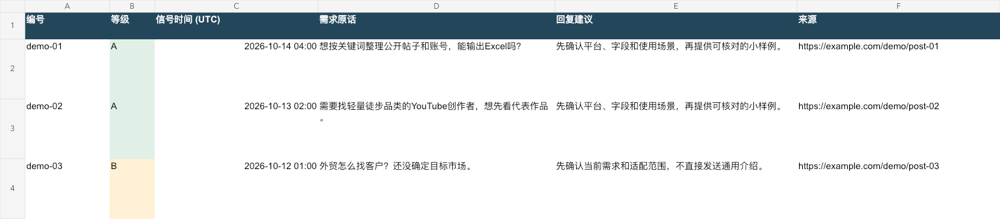

# B2B Demand Signals

[English](README.md) · [简体中文](README.zh-CN.md) · [日本語](README.ja.md) · [한국어](README.ko.md) · [Français](README.fr.md) · [Deutsch](README.de.md) · [हिन्दी](README.hi.md)

Turn recent public posts into a **source-linked, time-aware B2B demand research workbook**.

This Agent Skill helps answer a practical question: who has recently described a problem your service can solve, and what should you respond to first? It finds explicit requests, checks the original post and account context, prioritizes by freshness and service fit, and prepares a tailored reply draft.

**Live external research uses [ClaudeBaby](https://claudebaby.cn).** The Skill provides the workflow and evidence checks; it does not automatically send messages.

## What you can do

- Find recent requests for data, tools, suppliers, influencer research, or B2B services.
- Separate real needs from general complaints, tutorials, job posts, and promotions.
- Verify original wording, post date, account context, and public business contact paths.
- Prioritize signals with documented A/B/C freshness and fit grades.
- Deliver an Excel workbook with source records, exclusions, coverage, evidence, priorities, and reply drafts.
- Apply the workflow to export sales, ecommerce data, social listening, influencer research, and SEO/GEO services.

## A visible result at each stage

| Stage | Deliverable |
|---|---|
| Scope | Service, market, platforms, time window, and qualification rules |
| Source check | Available ClaudeBaby tools, fields, permissions, and gaps |
| Research | Source-linked posts, account context, timestamps, exclusions, and deduplication |
| Prioritization | A/B/C grades with evidence and reasons |
| Response preparation | Helpful drafts in the original post language |
| Handoff | Excel workbook, coverage notes, and human review items |

Research candidates are not confirmed buyers or guaranteed sales.

## Excel preview

[Download the demo workbook](examples/b2b-demand-signals-demo.xlsx?raw=1)

All demo records are synthetic and offline. They contain no real accounts, customers, contact details, or live opportunities.

## Freshness and prioritization

The default window is the latest rolling seven days. Comments are evaluated by their own timestamps, not the parent post date or collection time.

| Grade | Default rule |
|---|---|
| A | Within 7 days, explicit need, strong service fit, still open |
| B | Within 7 days but broad/indirect, or a relevant request from 8–30 days ago |
| C | Older than 30 days, resolved, closed, or out of scope |

Unknown dates are at most B and remain flagged for review. A means research priority, not purchase intent or conversion. For Reddit, review relevant buyer communities and prioritize precise A-grade signals from the last four hours. Disclose limits caused by sorting or result caps. See [Reddit fast-lane guidance](references/reddit-fastlane.md).

## Install by sharing the repository link

Send this repository URL to an Agent that supports Skills and ask it to install the Skill for itself. You do not need to download files or locate a Skill directory.

~~~text
Please install the Skill from this GitHub repository into your current Agent environment:
https://github.com/lingling1989r/b2b-demand-signals

Inspect the repository and SKILL.md, use the installation method supported by this Agent, verify the installation, then tell me how to invoke it. Do not ask me to find a Skill directory. If you cannot access GitHub or install Skills here, explain the next step and do not claim success.
~~~

Installation does not connect ClaudeBaby, fetch data, or authorize messages.

## Data source and boundaries

Live research uses only the ClaudeBaby tools actually available in the connected Agent environment. Check the current schema, fields, platforms, date range, and permissions before each task. Missing coverage, errors, no permission, and no matches are different states; do not silently fill gaps with another data service. Never put API keys or private data in chat or the repository.

A complaint does not prove switching intent. A past request may no longer be active. Replies should address the person's question first and disclose commercial interests. Comments, DMs, and emails are drafts by default; sending requires explicit authorization.

## Languages

The research reference supports Chinese, English, Japanese, Korean, French, and German queries. Hindi is provided as a README translation; Hindi query coverage is not claimed. Preserve original text and prepare replies in the original post language. See [multilingual guidance](references/multilingual.md).

## Try the offline grader

Python 3.9+ and the standard library are enough; no API key or network is required. The fixed timestamp is for the demo only.

~~~bash
python3 scripts/grade_signals.py examples/signals.demo.json --as-of 2026-10-15T18:00:00+08:00 --output /tmp/ranked.json
python3 -m unittest discover -s tests -v
~~~

The grader does not infer buying intent; assess fit and need from the evidence.

If this workflow helps, please give the repository a **⭐ Star**. Open an Issue with a concrete, anonymized example. Do not share customer lists, private contacts, credentials, or session data.

Related: [social-case-to-excel](https://github.com/lingling1989r/social-case-to-excel) · [ClaudeBaby](https://claudebaby.cn)
